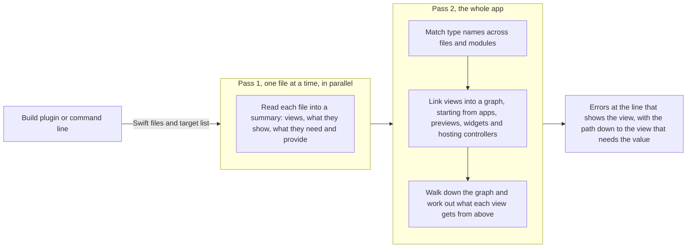

<p align="center"></p>

<h1 align="center">Snagless</h1>

<p align="center">
  <a href="https://github.com/tareksabry1337/snagless/actions/workflows/ci.yml"></a>
  <a href="https://github.com/tareksabry1337/snagless/releases/latest"></a>
  
  
  <a href="LICENSE"></a>
</p>

Snagless finds SwiftUI environment crashes before your users do.

A view that reads a value missing from its environment crashes the app. The compiler is happy with this, so it
ships:

```swift
@Observable final class Cart {
    var items: [String] = []
}

struct CartBadge: View {
    @Environment(Cart.self) private var cart

    var body: some View {
        Text("\(cart.items.count)")
    }
}

struct ContentView: View {
    var body: some View {
        NavigationStack {
            Text("Shop")
                .toolbar { CartBadge() }
        }
    }
}

@main
struct ShopApp: App {
    var body: some Scene {
        WindowGroup {
            ContentView()
        }
    }
}
```

That builds fine and crashes the moment the toolbar shows up. With Snagless in the build, the build fails,
pointing at the line that shows the view and the path down to the view that wanted the cart:

```
ShopApp.swift:26:13: error: `CartBadge` needs `Cart`: App `ShopApp` → ContentView → CartBadge (ShopApp.swift:6)
```

Add `.environment(Cart())` to `ContentView()` and the build passes again.

Snagless only reads your source code, which keeps it quick: a 431-file app takes about 90 ms.

## How well it works

**Against SwiftUI itself.** RuntimeCases is a small app with 53 cases, each built around one way of showing a view
or providing a value, and each run on the iOS 27 simulator to see whether it crashes. 31 crash and 22 render.
Snagless reports 30 of the 31 crashes; the one it misses is a value provided inside an `#if` (see "Limits"). Of
the 22 that render it stays quiet on 14 and reports 8:

- 2 show the same view as a case that crashes, with only a runtime flag deciding whether the value is provided, so
  the report is right for the app: an `if` that provides the value only when the flag is on, and an `.if(flag)`
  helper that does the same.
- 2 are reported by design. One is a view on a path the app skips, which is what ignore comments are for (see
  "When it's wrong"). The other declares an `@EnvironmentObject` it leaves unread (see "What it checks").
- 4 are false positives, listed under "Limits": a hosting controller added as a child, a
  `UIHostingConfiguration` cell, a value provided inside a closure passed to your own helper, and a value provided
  on a `NavigationSplitView` for a `navigationDestination` inside it.

**Against generated apps.** The tests generate apps of 500 and 2,000 views with crashes added at random, and
Snagless has to report exactly those crashes.

**Against a real app.** [IceCubes](https://github.com/Dimillian/IceCubesApp), an open-source Mastodon client, has
431 Swift files and 212 views. Snagless reports 39 problems, each checked by hand. 37 are in previews; each was
run on the iOS 27 simulator with everything else the preview needs provided. 27 of them crash. The other 10
render, because the view that needs the value only shows once data arrives that the preview lacks: accounts loaded
from the network, a gif header image, a follow relationship, a loaded status. The last 2 are in the share
extension, on a path it skips, which the ignore comment below handles.

**Speed.** Median of seven runs on an M1 Pro:

| App           | Size                 | Time   |
| ------------- | -------------------- | ------ |
| IceCubes      | 431 files, 212 views | 92 ms  |
| Generated app | 500 views            | 37 ms  |
| Generated app | 2,000 views          | 126 ms |
| Generated app | 10,000 views         | 584 ms |

## What it checks

Snagless starts everywhere SwiftUI views come to life: your `App` scenes, previews, widgets, and SwiftUI views
hosted from UIKit or AppKit. From each of those it walks down through every view that can be shown, and at each
view it checks that what the view reads from the environment was put there somewhere above it.

A view that reads from the environment but that none of those starting points shows stays unchecked. Each one
gets a warning, `` `Leaf` is unreachable from every App, preview and hosting root ``, and the summary line counts
them as unchecked views. Warnings leave the build passing. When the checked files have no `App`, widget or hosting
root, as when a package is checked on its own, the views get one warning instead, at the first of them:
`` `StatusDetailView` and 21 other views that read the environment are unchecked; run Snagless on the app that
shows them ``. `--verbose` lists them.

A view needs a value when it declares `@Environment(Cart.self)` or `@EnvironmentObject`, and Snagless reports
the declaration. A view with `@Environment(Cart.self)` crashes as soon as SwiftUI draws it; a view with
`@EnvironmentObject` crashes when it first reads the object. Each SwiftUI behaviour described here, apart from
widgets, has a case in RuntimeCases, run on the iOS 27 simulator. A value counts as provided by
`.environment(cart)` or `.environmentObject(store)`, including when that call lives inside one of your own view
modifiers or `View` extensions.

Snagless follows views through `body`, computed properties, helper methods, methods on other types that return
views (a router's `view(for:)`, for example), your own `Scene` types, generic wrapper views, sheets, navigation and
other modules. The `View` or `App` conformance and the `body` can be in an extension, in any file of the module.
A few SwiftUI rules decide what a view gets:

- A `navigationDestination` gets two things: the environment of its `NavigationStack`, and anything provided
  inside its own closure.
- A hosting controller you create and present from UIKit starts with an empty environment. So does a widget, which
  has no app around it.
- A hosting controller returned from `makeUIViewController` in a `UIViewControllerRepresentable` is part of the
  SwiftUI view around it, so it gets that view's environment.
- A sheet, popover or inspector gets the environment of the view that presents it.

To know what a value provides, Snagless needs its type in the source: an initializer, a property or local with a
type, a declared static member, a chain of declared members, a function that declares its return type, `x as Cart`,
or a ternary whose two sides have the same type. `--verbose` lists every line where the type stays unknown.

An optional value, such as a `Cart?` property that starts as `nil`, counts as provided only once it is unwrapped
with `if let`, `guard let` or `!`. SwiftUI accepts `.environment(cart)` with a `nil` cart, and the view that reads
`Cart` then crashes, so Snagless treats the optional as a value of unknown type.

### Environment keys that crash

A custom key whose default value calls `fatalError` or `preconditionFailure` is a crash waiting to happen. SwiftUI
runs the default whenever the key is read before it is set, and sometimes when it is set too, so the default itself
has to be safe. Snagless reports these once, at the default value, as soon as anything uses the key, and adds a
note at every place that sets it. The fix is a safe default (an optional or a placeholder value), or an
`@Observable` type read with `@Environment(Type.self)`.

## How it works



Pass 1 reads each file on its own, so files are read in parallel. Pass 2 works from the summaries alone.
CONTRIBUTING.md has the modules behind each step.

## Installation

### Swift package

```swift
dependencies: [
    .package(url: "https://github.com/tareksabry1337/snagless", from: "0.9.2"),
],
targets: [
    .target(
        name: "MyApp",
        plugins: [.plugin(name: "SnaglessPlugin", package: "snagless")]
    ),
]
```

The plugin checks the target and everything it depends on, on every build.

### Xcode project

1. Add the package with File, Add Package Dependencies.
2. Select your app target, open Build Phases, and add `SnaglessPlugin` under Run Build Tool Plug-ins. Xcode asks you
   to trust the plugin the first time.

Only add it to the app target. It checks the whole project from there: every target, every local package the
project uses, and the local packages those depend on.

### Command line

```
swift build -c release
.build/release/snagless path/to/MyApp
```

It exits with 0 when the run is clean or has only warnings, 1 when it finds an error, and 2 when the arguments are
wrong, a path is missing, or a file can't be read as UTF-8 text.

- `--package DIR` checks a local Swift package, using the module names from its `Package.swift`, along with the
  local packages it depends on. Repeat it for more packages. Plain folders get module names from their layout.
- `--previews error|warning|off` sets how problems that only happen in previews are reported. The default is
  `error`. With `off`, views that only previews show count as unchecked.
- `--legacy-sheets` checks sheets, popovers and full-screen covers as if they start with an empty environment.
  Use it if your app supports iOS 13 or 14, where developers report that sheets start with an
  empty environment.
- `--format text|github` sets how problems are printed. With `github`, each one is also printed as a GitHub Actions
  annotation, so it shows up on the line in the pull request. The plugin turns this on by itself when it runs on
  GitHub Actions.
- `--verbose` also lists unresolved values, unreachable views, and files it parsed only in part.
- `--timing` prints how long each step took.

## When it's wrong

Snagless reads code as written, so sometimes it needs a hint.

If a line provides a value of unknown type, like `.environment(container.resolve())`, name the type:

```swift
.environment(container.resolve()) // snagless: provides Cart
```

To silence a false report, name the type and give the reason:

```swift
embeddedStatus // snagless: ignore SceneDelegate - the share extension only creates new posts
```

On a view that's being shown, this means "assume `SceneDelegate` is there for everything below this point". On an
`@Environment` or `@EnvironmentObject` line, it drops that one requirement. On a key's crashing default, name the
key instead: `// snagless: ignore \.session - set before any view appears`. A comment on a line of its own applies to
the next line.

Ignores are deliberately narrow. Each one covers one type on one line, and the reason is required, so the next
person to read it knows why it's there. If an ignore stops matching anything, because the code moved or the
requirement went away, Snagless warns you so you can remove it. The summary line says how many ignores are in use.

The most common reason to need one is a view on a path your code skips. Snagless treats every branch of an `if` as
possible, so a view that a screen shows only in a mode one host avoids still gets reported, and an ignore with the
reason is the answer.

## Limits

- Every branch counts, including `#if`. A value provided in one branch of an `if`, or only under `#if DEBUG`,
  counts as provided everywhere, so a crash in another branch or in the Release build goes unreported.
  Requirements and views inside an `#if` are checked in every branch.
- Your own `View` extensions that provide a value are matched by name only. Two `themed()` extensions in different
  modules, or two overloads of `themed`, count as one that provides everything either provides, so a crash under
  the one that provides nothing goes unreported.
- An `@Observable` app delegate counts as provided in every `App` in the repository, not only in the `App` that
  declares the adaptor, so with two apps in one repository a crash in the other app goes unreported.
- Inside a representable, a hosting controller added as a child view controller and a `UIHostingConfiguration`
  cell both get the surrounding environment. Snagless treats them as starting empty, so it can report a false
  crash.
- A `navigationDestination` inside a `NavigationSplitView` gets the environment of the split view, as one inside a
  `NavigationStack` gets the stack's. Snagless checks it against what the root provides instead, so a value
  provided on the split view is missed and the destination is reported.
- A `navigationDestination` inside a `NavigationView` never presents on iOS 27. Snagless still checks it, so it
  can report a view that never shows.
- Macros stay unexpanded, so views and values a macro creates are invisible to Snagless.
- Binary frameworks have no source: values they provide show up as unknown, and views they show are skipped.
- A generic helper such as `func inject<T>(_ value: T) -> some View` hides what it provides.
- A value provided inside a closure you pass to your own helper, like `view.apply { $0.environment(cart) }`, is
  skipped, so the views inside can be reported even though they get it.
- Views kept in a dictionary or registry and looked up at runtime are skipped. Each one that reads from the
  environment gets a warning that it is unreachable.
- Typealiases are left unresolved.
- A function that returns `some`, `any` or a generic type, overloads that return different types, methods from
  protocol extensions, and a top-level function that returns an optional leave the type unknown.
- A call through a protocol counts as a call to every type that conforms to it.
- A call whose argument labels match one overload only loosely, because of default arguments or a trailing
  closure, counts as a call to every overload with that name.
- `Package.swift` is read as text, so targets built from variables or conditions are skipped.

ROADMAP.md lists the fixes planned for 1.0.

## Requirements

macOS 13 or later and Xcode 16 or later (Swift 6.0). Snagless builds against swift-syntax 604.0.0.

| Xcode | Swift | Prebuilt binary | From source |
| ----- | ----- | --------------- | ----------- |
| 27.0  | 6.4   | Tested          | Tested      |
| 26.4  | 6.3   | Tested          | Tested      |
| 16.0 to 26.3 | 6.0 to 6.2 | Not tested | Not tested |

Tested means both example projects fail on their missing `Cart`, and from source also that every test passes and
IceCubes gives the same output.

## Contributing

See CONTRIBUTING.md.

## License

MIT. See LICENSE and NOTICE.
